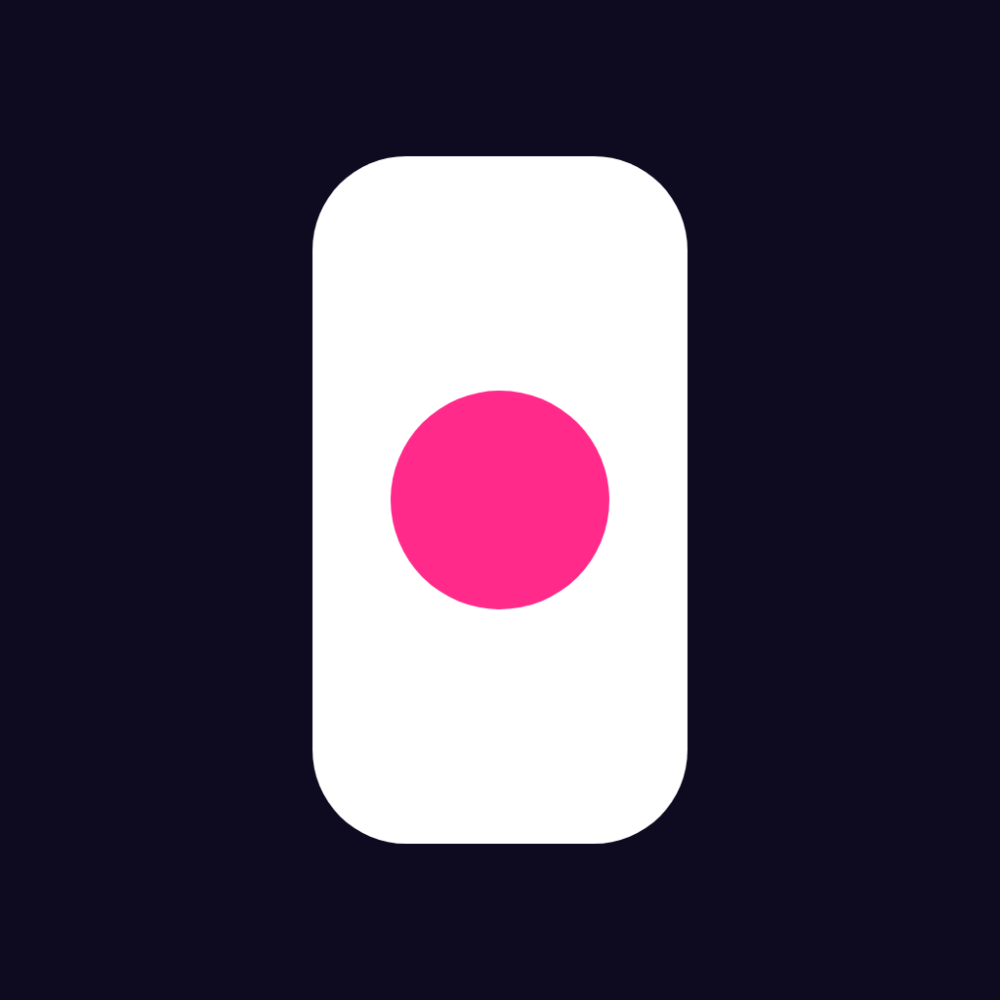
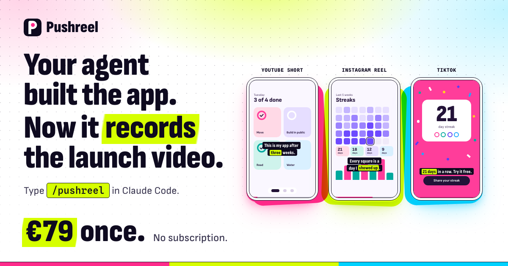
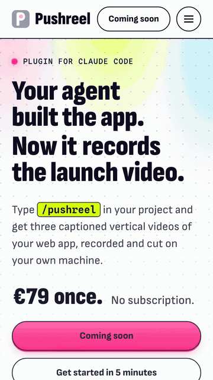
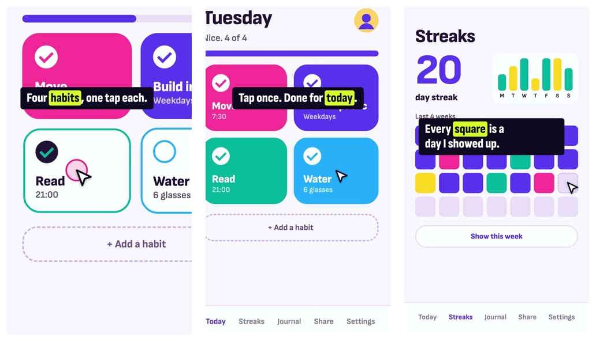

<p align="center">
  
</p>

<h1 align="center">Pushreel</h1>

<p align="center">
  <b>Your agent built the app. Now it records the launch video.</b><br>
  One command in Claude Code, three vertical videos of your web app: a YouTube Short, an Instagram Reel and a TikTok.
</p>

<p align="center">
  <a href="https://pushreel.dev">pushreel.dev</a> ·
  <a href="#quickstart">Quickstart</a> ·
  <a href="#commands">Commands</a> ·
  <a href="#data-network-and-privacy">Privacy</a> ·
  <a href="docs/USAGE.md">Docs</a>
</p>

<p align="center">
  
</p>

---

## Made with Pushreel

<p align="center">
  
</p>

<p align="center">
  The first seconds of the YouTube Short Pushreel recorded of its own website, from a shot list, in 47 seconds.<br>
  The agent-only run of the same page, where Claude explored the site and wrote the shot list itself, took nine steps and cost $0.18 on Claude Sonnet 5.5.
</p>

## What it does

You type `/pushreel` in your project. Claude reads the project, opens your running app and proposes a shot
list: which screens to show, what to click, one caption per scene. You confirm it, or change it in the
Studio. Then fixed code takes over. It records the app in a headless browser at 1080×1920, zooms in on
every click, burns in the captions, cuts the waiting out and exports three files in one run.

<p align="center">
  
</p>

```
pushreel-out/2026-11-17-tinywins/
  tinywins-short.mp4     YouTube Short     1080×1920, captions placed for Shorts
  tinywins-reel.mp4      Instagram Reel    same footage, captions placed for Reels
  tinywins-tiktok.mp4    TikTok            same footage, captions placed for TikTok
  tinywins-cover.png     Cover image       1080×1920
  captions.md            one post text per platform, as a draft
  shotlist.json          your scenes, to record or re-render later
  run.log                what happened, step by step
```

Everything runs on your machine. Your app, your code and your videos are never uploaded, and there is no
watermark. Pushreel does not post anything for you.

## Why a plugin and not a prompt?

You could ask Claude to write a Playwright script and a few ffmpeg commands. The first video would probably
work. The trouble starts on the second run: the model writes a new script and new flags each time, so timing,
type and caption positions change from video to video, and a failed click costs another round of tokens.

Pushreel splits the job. The model does what it is good at, once: understanding your app and writing the
shot list. Recording, retries, zooms, captions, safe areas and the three exports are fixed code. They cost
0 tokens and look the same on every run. When your UI changes, `/pushreel record` films the same shot list
again without asking the model.

## Quickstart

**1. Install** (Claude Code, Node 20+, ffmpeg on your PATH), in your terminal:

```bash
claude plugin install pushreel --marketplace IonFlux84/pushreel
```

This adds the Pushreel marketplace and installs the plugin in one go (Claude Code 2.1.292 or later). On an
older Claude Code, use two commands: `claude plugin marketplace add IonFlux84/pushreel`, then
`claude plugin install pushreel@pushreel`. Before installing, Claude Code shows its usual note that plugins
can run code on your machine. Everything Pushreel runs is in this repository: start with
[`hooks/hooks.json`](hooks/hooks.json) and [`bin/`](bin/).

**2. Download the recording browser once** (Chromium, about 100 MB), in Claude Code:

```
/pushreel setup
```

**3. Activate your licence** (the key comes by email after the purchase at [pushreel.dev](https://pushreel.dev)):

```
/pushreel activate <your-licence-key>
```

**4. Record** in the project of your web app:

```
/pushreel
```

Pushreel finds your app or starts it with your project's own dev command, explores it and shows you the shot
list. Your three videos land in `pushreel-out/`.

## Your brand, every run

```
/pushreel style init
```

reads your running app's main colour, font and logo and writes `pushreel.style.json` into your project. Commit
it, and every run uses it: captions, end card, cover, pointer and zoom, applied by fixed code with 0 tokens.
Start from a built-in style (`bold`, the default; `clean`; `neon`), or keep your own in `~/.pushreel/styles/`.

```json
{
  "extends": "clean",
  "template": "launch",
  "captions": { "font": "public/fonts/Inter-Bold.woff2", "highlight": "#e8590c" },
  "endCard": { "background": "#1c1917", "logo": "public/logo.svg", "cta": "Try it free at acme.app" },
  "rules": { "captions": { "maxWords": 6, "bannedWords": ["simply"] }, "paths": { "neverShow": ["/admin*"] } }
}
```

A story template (`/pushreel --template launch`: a hook, three features, the price) tells the agent which
scenes to find, and the validator refuses a shot list that breaks a rule it can measure: words per caption,
banned words, emoji, pages to show or never show, lengths, hashtags. Change the look later in the Studio's
**Style** screen and re-render without the model. Everything: [docs/STYLES.md](docs/STYLES.md).

## Updates

Updates are included through the end of 2027. Claude Code does not update plugins from third-party
marketplaces by itself, so get a new version in one of two ways:

- **Now:** `claude plugin update pushreel@pushreel` in your terminal, then `/reload-plugins` in an open session.
- **Automatically:** once in Claude Code, open `/plugin`, go to the **Marketplaces** tab, select **pushreel**
  and choose **Enable auto-update**. New versions then arrive in the background and load with the next session.

## Commands

| Command | What it does | Uses the model |
|---|---|---|
| `/pushreel` | Explore, propose a shot list, ask, then record, cut, export | yes |
| `/pushreel --yes` | The same without asking | yes |
| `/pushreel http://localhost:3000` | Use the app at this address | yes |
| `/pushreel --style neon`, `--template launch` | The same with a style or a story template | yes |
| `/pushreel style init` | Read your app's colour, font and logo into `pushreel.style.json` | no |
| `/pushreel style list`, `style show`, `template list` | The styles and templates, and where each value comes from | no |
| `/pushreel login` | Sign in to your app by hand once (OAuth, magic link, SSO); the session is reused | no |
| `/pushreel studio` | Open the review screen at http://localhost:4317 | no |
| `/pushreel record` | Record the saved shot list again after your UI changed | no |
| `/pushreel rerender` | Export again after changing captions, lengths, scenes or the style | no |
| `/pushreel resume`, `resume --skip 3,4`, `cancel` | Continue, skip or end a paused run | no |
| `/pushreel status`, `doctor` | Where the run stands, and what is missing on this machine | no |
| `/pushreel activate <key>`, `licence`, `deactivate` | Manage the licence | no |

"no" means fixed code does the work and it costs 0 tokens. If another command on your machine is also called
`/pushreel`, use the full name `/pushreel:pushreel`. Everything else, including the terminal commands, logins,
consent banners and what Pushreel writes where, is in [docs/USAGE.md](docs/USAGE.md).

## Models and cost

Pushreel uses the model of your Claude Code session and brings no API key of its own. **Claude Sonnet 5.5 is
the recommended model.** Before it starts exploring, Pushreel shows which model your session runs and what
this run is expected to cost, measured from your session.

In our measured runs on Sonnet 5.5 a full run cost **about $0.20 to $0.65** at API prices. Most of that is the
first turn writing your session's own context (`CLAUDE.md`, plugins, MCP servers) into Claude's cache, so a
run in a session you have just been working in costs less. On a Claude subscription a run counts against
your plan limits. After every run you get a table with the tokens and the cost per step.
Details: [docs/COSTS.md](docs/COSTS.md).

## Licence and price

Pushreel is paid software: **€79 once**, no subscription. One licence is for one person and can be active on
up to 3 machines at the same time. Updates are included through the end of 2027. The sale is handled by
Dodo Payments as merchant of record, and the key comes by email.

The source is public so you can read what it does before you run it. It is not open source: see
[LICENSE](LICENSE). Activation works offline after the first request, and the key is checked again at most
once every 30 days, only when you are online. Offline never blocks a recording.
Details: [docs/LICENSING.md](docs/LICENSING.md).

## Requirements

| | |
|---|---|
| Claude Code | tested with 2.1.326. Pushreel needs a terminal, a browser and ffmpeg, so it works in Claude Code, not in Claude chat or Cowork. |
| Node.js | 20 or newer |
| ffmpeg and ffprobe | on your PATH: `brew install ffmpeg`, `sudo apt install ffmpeg` or `winget install ffmpeg` |
| Chromium for Playwright | downloaded once by `/pushreel setup` |
| Operating system | tested on macOS. Linux should work. Windows is untested. |
| Your app | anything that renders in Chromium: React, Vue, Svelte, Next.js, Laravel, Rails, Django, plain HTML |

## Data, network and privacy

**Network requests.** Pushreel makes these requests and no others. There is no telemetry, no analytics,
no update check and no error reporting.

| When | To | What is sent |
|---|---|---|
| `pushreel activate <key>`, once per machine | Dodo Payments, `https://live.dodopayments.com/licenses/activate` | the licence key and a neutral machine label (`Pushreel on macOS · 3f9a`: operating system and four random characters). No hostname, no user name, no email, no project data. `--name <label>` sends your own label instead. |
| At most once every 30 days, when you are online and start a recording | Dodo Payments, `…/licenses/validate` | the licence key and the activation id. Offline never blocks: without an answer the run goes on. |
| `pushreel deactivate` | Dodo Payments, `…/licenses/deactivate` | the licence key and the activation id |
| `pushreel setup`, only when you run it or agree to it | Playwright's browser download server | a normal download request for Chromium |
| While exploring and recording | your own app, at the local address Pushreel found or you gave | the page requests a browser makes, plus the clicks and typing in the shot list |

Every request to Dodo Payments carries a `User-Agent: pushreel/<version>` header; Dodo sees your IP address,
as every server does. Dodo Payments is the merchant of record for the purchase; the activate answer
contains the buyer's name and email, and Pushreel does not store them. Details:
[docs/LICENSING.md](docs/LICENSING.md).

**What Pushreel runs on your machine.**

- If your app is not running, `begin` and `run` start it with your project's own start command (for
  example `npm run dev` or `composer run dev`, read from your project files) and stop it again at the end.
  An app that was already running is used and left running.
- A headless Chromium (Playwright) opens your app, clicks and types what the shot list says, and records
  it. If the page shows a cookie or consent dialog, Pushreel clicks the option with the least tracking
  (reject, necessary only) once, before recording, unless you ask for accept (`--consent accept`). This
  click happens in your app, so an app that keeps proof of consent records one answer per run.
- `pushreel login` opens a visible browser window on your app for you to sign in; the session is saved to
  `.pushreel/auth.json`. `PUSHREEL_LOGIN` (a test account for a password form) is read at run time and never
  written to disk by Pushreel.
- ffmpeg and ffprobe from your PATH cut and encode the videos.
- `pushreel studio` serves the review screen on `http://127.0.0.1:4317`, reachable from this machine only.
  It loads no remote fonts, scripts or images.
- Two Claude Code hooks (in `hooks/hooks.json`) run `node ${CLAUDE_PLUGIN_ROOT}/src/hook.js`: after
  `pushreel begin` it shows you the model and cost note as a system message, and after each answer it
  refreshes the token count of a running Pushreel run. Outside a Pushreel run both do nothing. Neither
  sends anything.

**The session transcript.** For the model note and the cost table, Pushreel reads the current Claude Code
session's transcript file (`~/.claude/projects/<project>/<session-id>.jsonl`) on your machine. It takes the
model name and the token counts of each answer. To check that you have seen the model note, it looks for
the note's two amounts in the assistant's visible text. It never stores or sends conversation content:
only model names, token counts, step times, the session id and the amounts it computes are written, to `.pushreel/cost.json`, `.pushreel/cost-marks.json`
and `.pushreel/model.json` in your project.

**Files Pushreel writes** (see also [What Pushreel writes](docs/USAGE.md#what-pushreel-writes)): `.pushreel/` and
`pushreel-out/` in your project, `pushreel.style.json` when you run `style init` or save in the Studio, and
`~/.pushreel/license.json` and `~/.pushreel/config.json` in your home folder. Nothing is written into `~/.claude`. All of it stays until you delete it.

**Privacy policy:** [pushreel.dev/privacy](https://pushreel.dev/privacy).
**Support and security reports:** [hello@pushreel.dev](mailto:hello@pushreel.dev).

## Limits

- Web apps only: anything that renders in Chromium. No native apps, no desktop apps, no extensions.
- Logins with 2FA or a captcha on every visit stop the scene.
- The browser session carries on from scene to scene (one for visitor scenes, one for signed-in scenes). What a scene changes in the app stays changed for the next one, like for a real user.
- Captions avoid the element that is clicked, large headings and fixed bars. They do not know about pictures, avatars or cards and can sit on those.
- Scenes whose steps end early are shortened: at most 2 s of still picture after the last action (`"cut": { "trimStillTails": false }` keeps the full length). The video can therefore be shorter than the sum of the durations.
- Pushreel clicks what a user would click. Point it at a development setup, not at production data.
- No voice-over and no music: the files have a silent audio track.
- Captions are in the language you (or the agent) write them in. One caption per scene.
- Recording captures up to 60 frames per second of real browser output and exports at a constant 30. Heavy WebGL or canvas scenes may stutter.
- The safe-area numbers are ad specifications or third-party figures, because none of the three platforms publishes numbers for normal posts. See [docs/PLATFORMS.md](docs/PLATFORMS.md).
- The per-step token numbers are an approximation. See [docs/COSTS.md](docs/COSTS.md).

## Docs

- [docs/USAGE.md](docs/USAGE.md): terminal use without Claude Code, logins and consent banners, files Pushreel writes, troubleshooting
- [docs/STYLES.md](docs/STYLES.md): styles, templates and rules, every setting
- [docs/ARCHITECTURE.md](docs/ARCHITECTURE.md): how it is built, the shot list format, the decisions
- [docs/LOGIN.md](docs/LOGIN.md): saved sessions, login scripts for CI, consent banners and `prepare`
- [docs/PLATFORMS.md](docs/PLATFORMS.md): platform values with sources
- [docs/LICENSING.md](docs/LICENSING.md): Dodo Payments, what is sent and stored, the re-check
- [docs/COSTS.md](docs/COSTS.md): how tokens are counted and what a run costs
- [docs/example-shotlist.json](docs/example-shotlist.json): a complete shot list

## Support

Questions, bugs and security reports: [hello@pushreel.dev](mailto:hello@pushreel.dev). Please attach the
`run.log` of the run. Pushreel is made by one person in Bochum, Germany, as part of the
[$100K Hackathon](https://ship-or-die.com/100k-hackathon).

Pushreel is independent and not affiliated with Anthropic. Claude is a trademark of Anthropic. YouTube,
Instagram and TikTok are trademarks of their owners.
